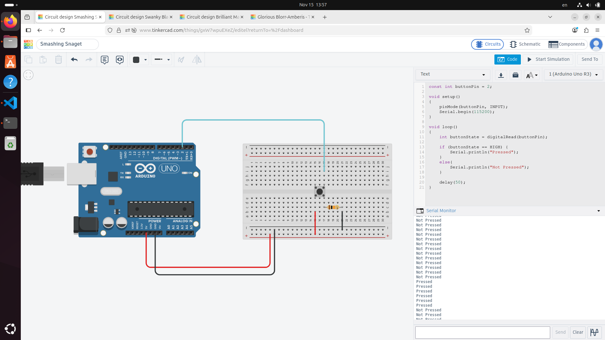
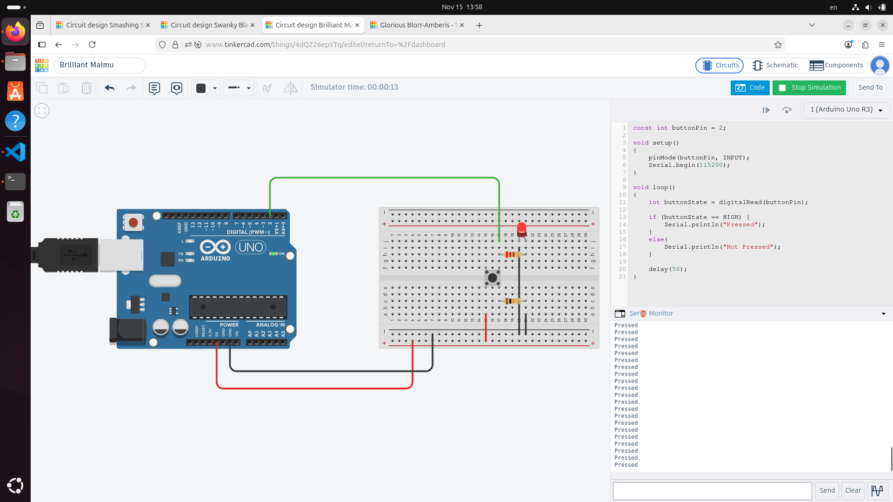
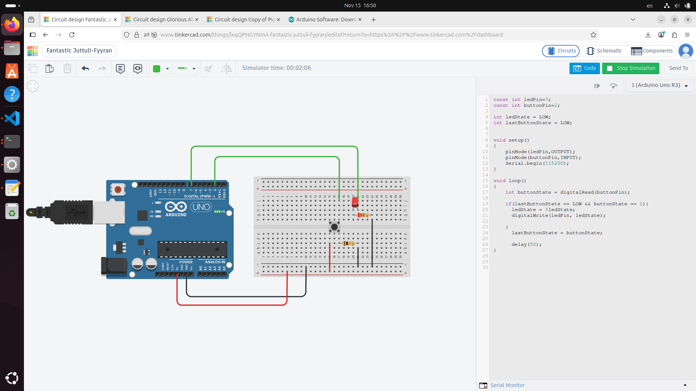
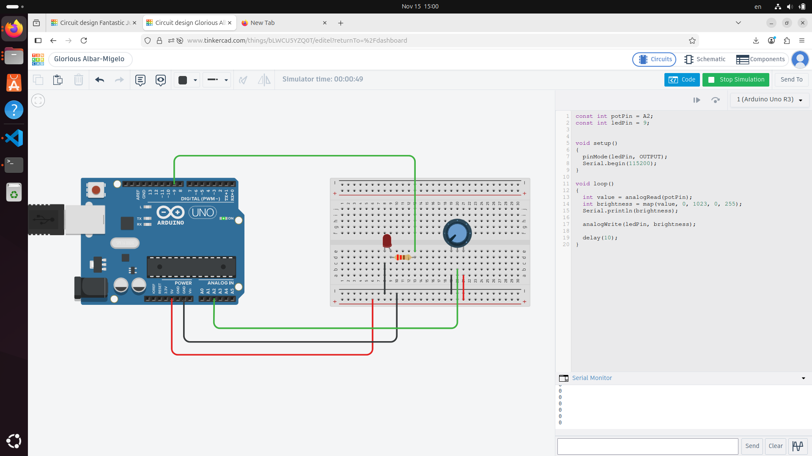

# 261115 실습 정리

## 실습 과정 및 결과

버튼 입력을 시리얼로 읽는 것부터 시작해 LED 연결, 토글, 가변저항을 이용한 밝기 조절 순서로 진행했습니다. 이후 ESP32에서는 서보 반복 회전과 가변저항 입력에 따른 각도 제어 코드를 작성했습니다.

| 실습 | 적용한 이론과 과정 | 결과 및 보완할 점 |
|---|---|---|
| 버튼 입력 | 풀다운 회로를 구성하고 D2를 읽어 시리얼 출력 | 버튼을 누르면 `Pressed`, 놓으면 `Not Pressed` 로그가 출력됩니다. |
| 버튼과 LED | 버튼 회로에 LED와 직렬 저항 추가 | 코드의 LED 출력 명령이 아닌 회로 연결로 동작합니다. |
| LED 토글 | 이전,현재 입력을 비교해 상승 에지에서 LED 상태 반전 | 실제 버튼에서는 바운싱도 고려해야 합니다. |
| LED 밝기 | A2 입력 0–1023을 D9 PWM 0–255로 변환 | 세 화면에서 출력값 0,127,255를 확인할 수 있습니다. |
| 서보 반복 회전 | 반복문으로 목표 각도를 1도씩 증가 | 현재 코드는 0–179도 증가 후 바로 0으로 돌아갑니다. 왕복하려면 감소 루프가 필요합니다. |
| 가변저항–서보 | GPIO39의 ADC 입력을 GPIO14 서보의 목표 각도로 변환 | 기본 12비트 입력에 맞게 `map` 범위를 수정해야 합니다. |

## 파일 구조

```text
261115/
├── README.md
├── tinkerCAD/
│   ├── pushbutton.png              # 버튼 상태 읽기
│   ├── pushbutton_with_LED.png     # 버튼 회로에 LED 추가
│   ├── button_toggle.png           # 버튼으로 LED 토글
│   ├── potentiometer_low.png       # PWM 값 0
│   ├── potentiometer_medium.png    # PWM 값 127
│   └── potentiometer_high.png      # PWM 값 255
└── servo_test/
    ├── servo_wiper/
    │   └── servo_wiper.ino         # 서보 반복 회전
    └── servo_potentiometer/
        └── servo_potentiometer.ino # 가변저항으로 서보 제어
```

## Tinkercad 코드 및 실행 방법

각 이미지에 표시된 코드를 아래에 정리했습니다. Tinkercad Circuits에서 Uno R3 회로를 구성하고 Code → Text에 해당 코드를 넣은 다음 Start Simulation을 누릅니다.

### 1. 버튼 상태 읽기

D2를 입력으로 사용하고 외부 풀다운 저항을 연결합니다. 시리얼 모니터에서 누르면 `Pressed`, 놓으면 `Not Pressed`가 출력되는지 확인합니다. 보드레이트는 115200입니다.



```cpp
const int buttonPin = 2;

void setup()
{
  pinMode(buttonPin, INPUT);
  Serial.begin(115200);
}

void loop()
{
  int buttonState = digitalRead(buttonPin);

  if (buttonState == HIGH) {
    Serial.println("Pressed");
  }
  else {
    Serial.println("Not Pressed");
  }

  delay(50);
}
```

### 2. 버튼 회로에 LED 추가

1번과 같은 코드를 사용하고 아래 이미지처럼 LED와 저항을 추가합니다. 버튼에 따른 LED 점등과 시리얼 출력을 확인합니다.



### 3. 버튼으로 LED 토글

D2에 풀다운 버튼, D7에 LED와 직렬 저항을 연결합니다. 버튼을 누를 때마다 LED가 켜지거나 꺼지고, 손을 떼도 상태가 유지되는지 확인합니다.



```cpp
const int ledPin = 7;
const int buttonPin = 2;

int ledState = LOW;
int lastButtonState = LOW;

void setup()
{
  pinMode(ledPin, OUTPUT);
  pinMode(buttonPin, INPUT);
  Serial.begin(115200);
}

void loop()
{
  int buttonState = digitalRead(buttonPin);

  if (lastButtonState == LOW && buttonState == 1) {
    ledState = !ledState;
    digitalWrite(ledPin, ledState);
  }

  lastButtonState = buttonState;
  delay(50);
}
```

이전 LOW, 현재 HIGH일 때만 상태를 바꿉니다. `delay(50)`은 읽기 간격을 주기 위해 사용합니다.

### 4. 가변저항으로 LED 밝기 조절

가변저항의 양 끝을 5V와 GND, 가운데 단자를 A2에 연결합니다. LED와 직렬 저항은 PWM 핀 D9에 연결합니다. 가변저항을 돌려 밝기와 시리얼 출력값이 달라지는지 확인합니다.

```cpp
const int potPin = A2;
const int ledPin = 9;

void setup()
{
  pinMode(ledPin, OUTPUT);
  Serial.begin(115200);
}

void loop()
{
  int value = analogRead(potPin);
  int brightness = map(value, 0, 1023, 0, 255);
  Serial.println(brightness);

  analogWrite(ledPin, brightness);
  delay(10);
}
```

저장된 화면의 시리얼 값은 최소 0, 중간 127, 최대 255입니다. 이 값은 밝기 측정값이 아니라 PWM 출력에 지정한 값입니다. 값이 커질수록 LED 밝기가 증가하는 것을 확인할 수 있습니다.

<p>
  
  
  
</p>

## ESP32 .ino 실행 방법

Arduino IDE에 ESP32 보드 패키지와 `ESP32Servo` 라이브러리를 설치하고, 사용하는 보드와 USB 포트를 선택합니다. 서보의 노란색 신호선은 GPIO14, 빨간색 전원선은 5V, 갈색 접지선은 GND에 연결합니다.

아래는 기존 실습 코드에서 부족했던 점과 개선 코드 예시를 정리한 내용입니다. 제출한 `.ino` 파일은 기존 실습 코드이며, 개선 코드는 README에만 제시했습니다.

### 1. servo_wiper.ino

#### 기존 코드

```cpp
#include <ESP32Servo.h>

#define SERVO_PIN 14

Servo myServo;

void setup() {
  myServo.attach(SERVO_PIN);
  myServo.write(0);
}

void loop() {
  for (int position = 0; position < 180; position++) { // for loop를 사용한 구현
    myServo.write(position);
    delay(10);
  }
}
```

#### 기존 코드에서 개선할 부분

- `position < 180`이므로 목표 각도는 0–179도까지 증가
- 감소하는 반복문이 없어서 마지막에는 목표값이 바로 0으로 돌아감
- 와이퍼처럼 왕복하려면 **증가 → 감소**하는 반복문이 모두 필요

#### 개선 코드

```cpp
#include <ESP32Servo.h>

#define SERVO_PIN 14

Servo myServo;

void setup() {
  myServo.attach(SERVO_PIN);
  myServo.write(0);
}

void loop() {
  for (int position = 0; position <= 180; position++) {
    myServo.write(position);
    delay(10);
  }

  for (int position = 179; position > 0; position--) {
    myServo.write(position);
    delay(10);
  }
}
```

0–180도로 증가한 뒤 179–1도로 감소하고, 다음 `loop()`에서 0도로 이어집니다. 목표값을 1도씩 바꾸므로 기존 코드처럼 179도에서 바로 0도로 명령이 바뀌지 않습니다. `delay(10)`은 명령 사이의 간격입니다.

#### 실행 방법

1. `servo_test/servo_wiper/servo_wiper.ino`를 엽니다.
2. 서보의 신호선, 전원선, GND 연결을 확인합니다.
3. 증가 방향과 감소 방향의 반복문을 추가한 개선 코드를 적용합니다.
4. 컴파일한 뒤 ESP32에 업로드합니다.
5. 서보가 양쪽 방향으로 반복해서 왕복하는지 확인합니다.

### 2. servo_potentiometer.ino

#### 기존 코드

```cpp
#include <ESP32Servo.h>

#define SERVO_PIN 14
#define POT_PIN 39

Servo myServo;

void setup() {
  myServo.attach(SERVO_PIN);
  myServo.write(0);
}

void loop() {
  int value = analogRead(POT_PIN);
  int position = map(value, 0, 1023, 0, 180);  // 가변저항 입력값을 서보모터 동작범위 180도로 매핑

  myServo.write(position);
  delay(10);
}
```

#### 기존 코드에서 개선할 부분

- 기존 코드는 `map(value, 0, 1023, 0, 180)` 사용
- ESP32의 기본 ADC 반환값은 **12비트, 0–4095** → 입력 범위가 맞지 않음
- 예를 들어 ADC 값 2048을 기존 식에 넣으면 `position`은 360이 됨
- 수업에서 배운 ESP32의 기본 ADC 범위에 맞춰 **`1023`을 `4095`로 수정**

#### 개선 코드

```cpp
#include <ESP32Servo.h>

#define SERVO_PIN 14
#define POT_PIN 39

Servo myServo;

void setup() {
  myServo.attach(SERVO_PIN);
  myServo.write(0);
}

void loop() {
  int value = analogRead(POT_PIN);
  int position = map(value, 0, 4095, 0, 180);

  myServo.write(position);
  delay(10);
}
```

수업에서 배운 ESP32의 기본 ADC 입력 범위 0–4095를 사용합니다. 기존 코드에서 `map`의 입력 최댓값만 1023에서 4095로 바꾸면, 입력 0–4095가 목표 각도 0–180도에 대응하도록 개선할 수 있습니다.

#### 실행 방법

1. `servo_test/servo_potentiometer/servo_potentiometer.ino`를 엽니다.
2. 서보 연결을 유지하고, PCB에 부착된 가변저항을 사용합니다. 가변저항의 입력은 GPIO39로 읽습니다.
3. `map`의 입력 범위를 0–4095로 수정합니다.
4. 컴파일한 뒤 ESP32에 업로드합니다.
5. 보드의 가변저항을 돌려 입력에 따라 서보가 움직이는지 확인합니다.

ADC 값 0 / 2048 / 4095는 계산상 목표 각도 0 / 90 / 180도에 대응합니다. 실제 가변저항의 중간 위치나 모터 각도는 측정해서 확인해야 합니다.

현재 서보 코드에는 시리얼 출력이 없습니다. 입력값도 확인하려면 `setup()`에 `Serial.begin(115200)`, 값을 읽은 뒤 `Serial.println(value)`를 추가합니다.

## 배운 이론 정리

### 로봇 자율주행: 고수준 판단 및 저수준 제어

- Input / Output Register
  - Input Register: 핀의 입력 상태를 읽음
  - Output Register: 핀의 출력 상태를 설정
- DDR (Data Direction Register)
  - 핀의 입력 / 출력 방향 설정
  - AVR 계열에서 쓰는 명칭. ESP32는 내부 구조가 다름.

전류 컨트롤이 중요하다!

- LED 등에는 저항을 연결해서 전류 제한

Pin: 전압을 감지하는 센서처럼 입력을 읽는 역할

- 디지털 입력은 HIGH / LOW를 판정
- ADC 입력은 아날로그 전압을 숫자로 읽음

#### Pull Down Resistor

- 버튼이 눌리면 HIGH, 안 눌린 상태는 LOW
- 입력을 저항으로 GND에 연결

#### Pull Up Resistor

- 버튼이 눌리면 LOW, 안 눌린 상태는 HIGH
- VCC랑 저항이 연결되어야 한다.
- 입력을 저항으로 VCC에 연결

저항은 **Resistor**, MCU 내부 레지스터는 **Register**

### Serial Communication

- **Baud Rate**
  - 일반적인 2레벨 UART에서는 bit/s와 수치가 같음.
  - 정확히는 초당 심벌 수를 의미함.
  - 보내는 쪽과 받는 쪽의 설정을 맞춰야 한다.
  - `Serial.begin(115200)` → 시리얼 모니터도 115200
- `Serial.print`: 줄바꿈 없이 출력
- `Serial.println`: 출력 후 줄바꿈
- 깨진 문자가 나오면 보드레이트와 포트 확인

### 버튼 토글

- 누르고 있는 상태와 누르는 순간은 다르다.
- 이전 LOW → 현재 HIGH인 **Rising Edge**에서 LED 상태 반전
- HIGH → LOW는 **Falling Edge**
- 실제 버튼 접점이 짧게 여러 번 튀는 현상 → **Bouncing**
  - 이를 걸러내는 처리 → **Debouncing**
  - `delay(50)`으로 읽기 간격을 주는 것과 안정 시간을 확인하는 디바운싱은 구분

### 가변저항 / ADC / PWM

- 가변저항 양 끝은 전원과 GND, 가운데 단자는 입력 핀에 연결
- **ADC**로 전압을 읽어서 숫자로 변환
  - Uno: 10비트, **0–1023**
  - ESP32 기본 반환값: 12비트, **0–4095**
- **PWM - Pulse Width Modulation**
  - HIGH / LOW를 빠르게 반복하면서 켜져 있는 시간의 비율 조절
  - **Duty Cycle**: 한 주기 중 HIGH인 시간의 비율
  - **Frequency**: `1 / 주기`
- Uno LED 밝기 조절은 PWM 핀에 `analogWrite` 사용
  - **0–1023 입력 → `map` → 0–255 출력**
  - `map`은 범위 밖 값을 자동으로 제한하지 않음

### 서보 / IMU

- 서보는 제어 펄스 폭으로 목표 각도 지정
  - `ESP32Servo`의 `attach`로 핀 연결, `write`로 목표 각도 설정
  - LED PWM처럼 듀티비 50% = 90도라고 생각하면 안 됨.
- **IMU - Inertial Measurement Unit**
  - 가속도계: 가속도 측정
  - 자이로: **각속도** 측정. 각도를 직접 측정하는 게 아님.
  - 지자기계: 자기장 측정, 주변 자석 등의 영향을 받음
  - 수업에서는 가속도계,자이로 위주로 설명
- **LiDAR**: 레이저로 거리 측정 → 이후 ROS2와 연결
- **UART / I2C / SPI**: 외부 장치 통신
  - I2C는 SDA / SCL, SPI는 클록,데이터,장치 선택 신호 사용
- 실제 연결할 때 전원,신호선 구분, **Common Ground** 잊지 않기
