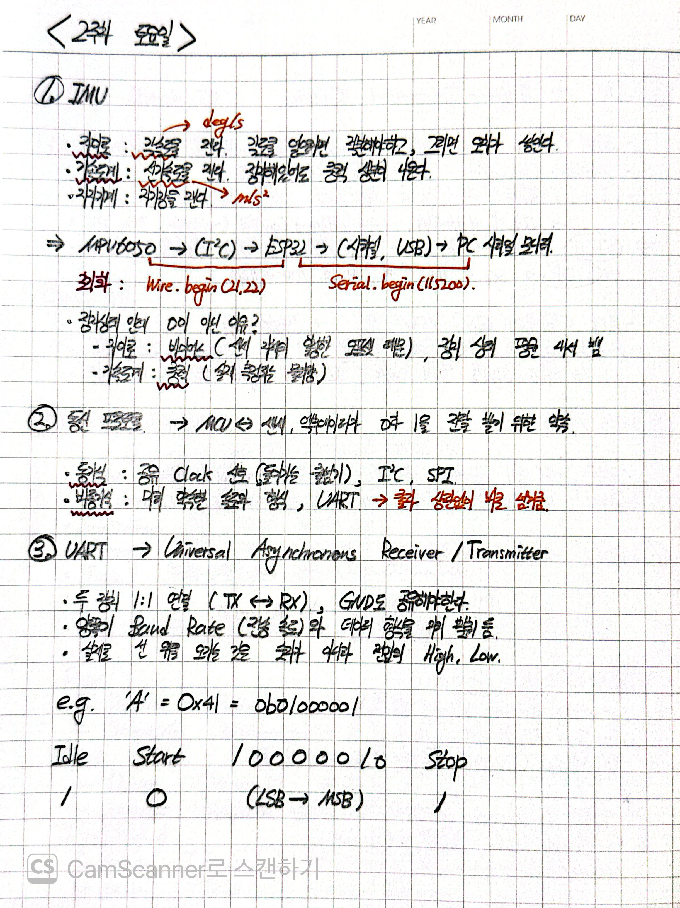
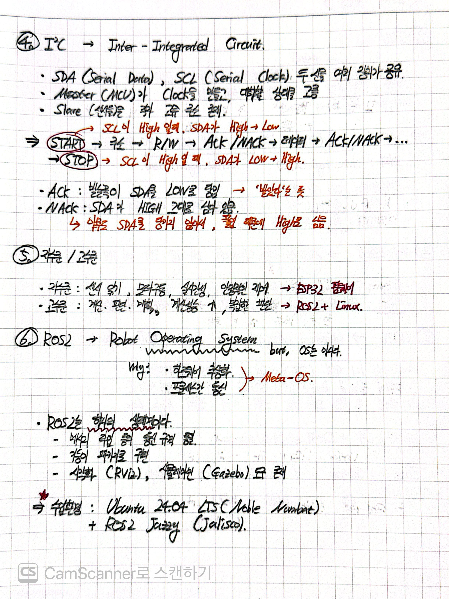
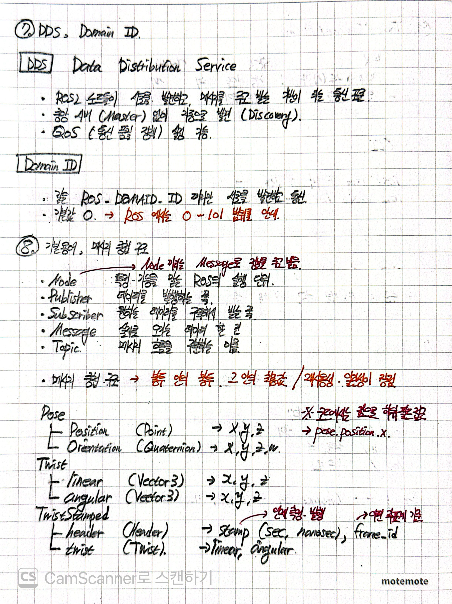
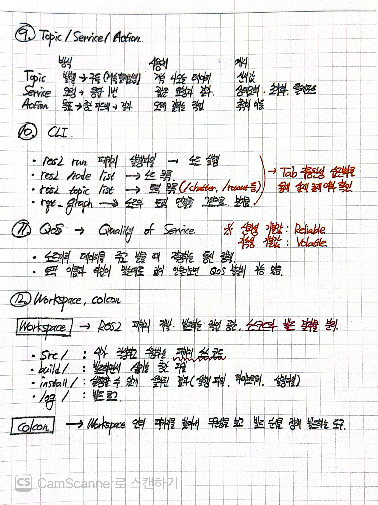

# 261121 실습 정리

## 실습 과정 및 결과

조립한 로봇의 IMU, LiDAR, 모터를 ESP32 샘플 코드로 테스트해보았습니다. 
IMU는 I²C, LiDAR는 UART로 값을 읽어 시리얼 모니터에서 확인했고, 모터는 바퀴 4개를 하나씩 양방향으로 돌려보는 실습을 진행하였습니다.

이후 ROS2 환경을 설정하고 talker / listener, turtlesim으로 토픽 통신을 명령어로 먼저 확인했습니다. 마지막으로 `1_pubsub` 패키지를 만들어 Python으로 talker와 listener 노드를 직접 작성했습니다.

## 파일 구조

```text
261121/
├── README.md
├── notes/                      # 손필기 노트
│   ├── 26-2-1-1.JPG
│   ├── 26-2-1-2.JPG
│   ├── 26-2-1-3.JPG
│   └── 26-2-1-4.JPG
├── 1_pubsub/
│   ├── 1_pubsub/
│   │   ├── __init__.py
│   │   ├── talker.py           # /demo_topic 발행
│   │   └── listener.py         # /demo_topic 구독
│   ├── resource/1_pubsub
│   ├── test/
│   ├── package.xml
│   ├── setup.cfg
│   └── setup.py                # talker, listener 실행 등록
└── sample_code/
    └── Arduino/
        ├── imu_test/
        │   └── imu_test.ino    # MPU6050 (I²C)
        ├── lidar_test/
        │   └── lidar_test.ino  # LiDAR (UART)
        └── motor_test/
            └── motor_test.ino  # 모터 4개 양방향 회전
```

## 실습 환경 및 의존성

### ROS2 실습

- Ubuntu 24.04 (Noble)
- ROS2 Jazzy
- Cyclone DDS
- colcon
- rclpy, std_msgs

### ESP32 실습

- ESP32 D1 R32 계열 개발 보드
- Arduino IDE
- ESP32 보드 패키지
- Wire 라이브러리
- MPU6050 IMU
- LiDAR
- DC 모터 4개, 모터 드라이버

## 구현 결과

### 1_pubsub

#### talker.py

```python
self.publisher_ = self.create_publisher(String, '/demo_topic', 10)
self.start_time = time.time()
self.timer = self.create_timer(1.0, self.publish_message)

def publish_message(self):
    elapsed = int(time.time() - self.start_time)

    msg = String()
    msg.data = f"Hello ROS2: {elapsed}"
    self.publisher_.publish(msg)
    self.get_logger().info(f'Publishing: "{msg.data}"')
```

1초마다 실행 후 경과 시간을 문자열에 담아 `/demo_topic`으로 발행합니다. 

#### listener.py

```python
self.subscription_ = self.create_subscription(String, '/demo_topic', self.callback, 10)

def callback(self, msg):
    self.get_logger().info(f'Received: "{msg.data}"')
```

같은 토픽 이름과 타입으로 구독하고, 메시지가 올 때마다 `msg.data`를 출력합니다.

talker를 먼저 켜 두고 listener를 나중에 켜면 1번부터가 아니라 그때 발행 중인 번호부터 받습니다. 지난 메시지는 따로 보관하지 않기 때문입니다.

### sample_code

#### imu_test.ino

- SDA는 GPIO21, SCL은 GPIO22, MPU6050 주소는 `0x68`
- 처음에 sleep 상태라서 `0x6B` 레지스터에 `0x00`을 써서 깨움
- `0x3B`부터 14바이트를 읽음 → 가속도 6 + 온도 2 + 자이로 6
- 상위 바이트를 8비트 밀고 하위 바이트와 OR해서 16비트 값으로 합침
- 가속도는 m/s², 자이로는 deg/s로 바꿔서 출력

가만히 둬도 자이로 값이 딱 0이 나오지 않고, 가속도는 한 축에 약 10–11이 나왔습니다. 원래대로라면 중력 가속도 때문에 9.8 정도가 나와야 합니다.

#### lidar_test.ino

- LiDAR → ESP32 RX(GPIO16), 230400 baud, 8N1
- PC 출력은 `Serial`, LiDAR 수신은 `Serial2`
- 패킷 47바이트, `0x54` `0x2C`로 패킷 시작을 찾음
- 패킷 하나에 측정점 12개, 각 점은 거리 2바이트 + 신뢰도 1바이트
- 각도는 100을 곱한 값으로 오니까 100으로 나눔
- 한 바퀴 돌면 0–359도 거리를 전부 출력

IMU는 상위 바이트가 먼저 오는데, LiDAR는 하위 바이트가 먼저 옵니다. 360개를 한 번에 출력하면 빠르게 값이 변하는 것을 확인할 수 있었습니다.

#### motor_test.ino

| IN1 | IN2 | 동작 |
|---|---|---|
| HIGH | LOW | 한 방향 회전 |
| LOW | HIGH | 반대 방향 회전 |
| HIGH | HIGH | 브레이크 |
| LOW | LOW | 출력 끔 |

FR → FL → RR → RL 순서로 1초 회전, 잠깐 멈춤, 1초 반대 회전을 반복합니다.

## 결과 분석

### IMU
- 정지 상태에서 자이로가 0이 아니고, 가속도는 한 축에 약 10–11로 9.8보다 크게 나왔습니다.
- 원인(추정): 자이로에는 바이어스가, 가속도계에도 오프셋, 스케일 오차가 있는데, 이번 코드는 보정 없이 값을 출력해서 이론값과 차이가 나는 것 같습니다.

### LiDAR 각도와 로봇 방향
- 샘플 코드 기준으로 Back 0°, Left 90°, Front 180°, Right 270°입니다.
- 0°가 로봇 정면이 아니고, 장착 방향에 따라 달라집니다. 실제로 쓸 때는 정면에 물체를 두고 어느 각도의 거리가 줄어드는지 확인해야 합니다.

### talker / listener
- listener를 늦게 켜면 1번부터가 아니라 그때 발행 중인 번호부터 받았습니다.
- 기본 QoS의 Durability가 Volatile이라, 발행 쪽이 지난 메시지를 보관하지 않기 때문입니다.
- 지도처럼 늦게 온 구독자도 받아야 하는 데이터는 Transient Local을 사용하면 해결할 수 있습니다.

## 실행 방법

### 1_pubsub

1. `1_pubsub` 폴더를 `colcon_ws/src/` 안에 넣습니다.
2. 워크스페이스 루트에서 빌드하고 `source`합니다.

```bash
cd ~/robot_navigation/colcon_ws
colcon build --packages-select 1_pubsub
source install/setup.bash
```

3. 터미널 두 개에서 각각 실행합니다. 새 터미널에서도 `source install/setup.bash`를 해야 합니다.

```bash
ros2 run 1_pubsub talker
ros2 run 1_pubsub listener
```

4. `ros2 topic list`, `ros2 topic echo /demo_topic`, `rqt_graph`로 연결을 확인합니다.

### sample_code

1. Arduino IDE에서 `.ino` 파일을 엽니다.
2. ESP32 보드와 USB 포트를 선택합니다.
3. 센서와 모터를 코드의 핀 번호대로 연결하고 GND를 공유합니다.
4. 업로드한 뒤 시리얼 모니터를 115200으로 맞춥니다.

LiDAR의 230400은 ESP32와 LiDAR 사이 속도이고, 시리얼 모니터는 115200입니다.

## 필기 정리 노트

<p>
  
  
</p>
<p>
  
  
</p>


## 배운 이론 정리

### IMU

**I**nertial **M**easurement **U**nit

- Gyro - 각속도
- Accelerometer - 선가속도
- Magnetometer - 나침반 (자기장)
  - 주변 전자기기, 자석 영향을 받아서 이번엔 자이로, 가속도 위주

정지해 있어도 값이 0이 아님

- 자이로: 일정한 오프셋 → **바이어스**
  - 가만히 둔 상태 값을 여러 번 모아서 평균 내고 빼서 보정
- 가속도: 중력 때문에 한 축에 약 9.8
  - 어느 축에 어떤 부호로 나올지는 센서 다는 방향에 따라 다름

센서 → MCU → PC

- 센서 ↔ 보드 통신이랑 보드 ↔ PC 통신은 따로 생각하기
- `Serial.begin`은 PC 쪽, `Wire.begin`은 센서 쪽

### 임베디드 통신 프로토콜

- MCU와 센서, 액추에이터 사이에서 0과 1을 주고받기 위한 약속
- 주로 **직렬 통신** 사용
- **동기식**: Clock 신호에 맞춰서 송수신
- **비동기식**: Clock 없이 **약속된 전송 속도와 형식**으로 송수신

e.g. 단체 줄넘기

- 동기식 → 줄(Clock) 박자에 맞춰 들어가서 같이 뛰면서 대화. 타이밍이 중요
- 비동기식 → 줄 상관없이 그냥 넘겨줌. 쌓인 데이터를 나중에 읽을 수 있지만 너무 쌓이면 버퍼 관리 문제
- 동기 / 비동기 구분 기준은 버퍼가 아니라 **Clock 공유 여부**

#### 대표적인 통신 인터페이스

- **UART**: 비동기, TX / RX. LiDAR, GPS
- **I²C**: 동기, 주소 기반, SDA / SCL. IMU, OLED
- **SPI**: 동기. SD카드, 디스플레이
- **CAN**: 비트 타이밍 동기화 방식. 차량

### UART

Universal Asynchronous Receiver / Transmitter

- 두 장치 간 1:1 직렬 통신
- **TX → 상대 RX, RX → 상대 TX** (교차 연결)
  - e.g. TX는 입, RX는 귀
- **Clock 없이 약속된 Baud Rate로 통신** → 양쪽 설정이 다르면 글자 깨짐
- Start Bit, Data Bit, (Parity Bit), Stop Bit로 프레임 구성
- 실제로 오가는 건 숫자가 아니라 전압의 High / Low

A = `0x41` = `0b01000001`

- LSB: 가장 낮은 자리 비트, MSB: 가장 높은 자리 비트
- UART는 LSB부터 보냄
- **8N1** = Data 8비트, Parity 없음, Stop 1비트

```text
Idle  Start  1 0 0 0 0 0 1 0  Stop
 1      0    (LSB → MSB)       1
```

### I²C

Inter-Integrated Circuit

Inter → 서로 다른 대상들이 연결되어 있다.

- 적은 선으로 MCU와 여러 장치를 연결하는 **동기식** 직렬 통신
- **SDA**(Serial Data), **SCL**(Serial Clock) 두 선
  - 동기식이라 Clock선이 있음
  - 전원, 공통 GND는 따로
- **Master**: Clock을 만들고 대화할 장치를 고름 (MCU)
- **Slave**: 센서들. 각자 **고유 주소**가 있음
  - 7비트 주소 + R/W 1비트 = 1바이트
  - MPU6050 = `0x68`
- 주소로 같은 선에 붙은 여러 장치와 통신 가능
  - 주소가 같은 장치는 같이 못 붙임

통신 순서

- START → 주소 + R/W → ACK/NACK → 데이터 → ACK/NACK → STOP
- 평소엔 풀업 저항 때문에 SDA, SCL 둘 다 HIGH
- **START**: SCL HIGH일 때 SDA HIGH → LOW
- **STOP**: SCL HIGH일 때 SDA LOW → HIGH
- **ACK**: 받는 쪽이 SDA를 LOW로 당김 → 내가 맞다, 받았다
- **NACK**: SDA가 HIGH 그대로 → 그 순간 응답한 장치가 없거나, 받을 수 없는 상태
  - 선택되지 않은 장치들이 각자 NACK를 보내는 게 아님. 아무도 SDA를 안 당기면 풀업 때문에 HIGH로 남는 것
  - 마스터가 마지막 바이트를 읽고 "그만 보내라"는 뜻으로도 씀. 항상 오류는 아니다
- e.g. 출석 부르기. 주소 부르기 = 이름 부르기, ACK = 손 들기

### 저수준 → 고수준

- 지금까지는 센서 읽기, 모터 구동 → 저수준
  - 실시간성, 안정적인 제어가 중요
- 이제 Linux + ROS2로 계산, 판단, 계획 → 고수준
  - 계산 성능, 복잡한 판단이 중요
- 로봇은 비싸고 망가질 수 있으니까 시뮬레이션으로 먼저 검증
  - 시뮬레이션 → 실제 로봇 = **Sim to Real**

### ROS2 개요

#### ROS = Robot Operating System

→ 말이 OS이지, OS가 아니라 소프트웨어 프레임워크 (미들웨어)

- e.g. 집 지을 때 철골, 자재, 도구를 매번 새로 안 만드는 것처럼 로봇 개발 공통 기반을 제공

#### OS의 핵심 역할

- **하드웨어 추상화**
  - 하드웨어마다 다른 동작 방식과 세부 구현을 숨김
  - 개발자는 세부 사항 대신 일관된 인터페이스 사용
  - 그래도 드라이버랑 설정은 있어야 함
- **프로세스 간 통신**
  - 각 프로세스는 분리된 메모리 공간에서 실행
  - 프로세스끼리 데이터를 안전하게 주고받도록 지원
- **Meta-OS**
  - OS 위에서 OS 같은 역할을 일부 함
  - 메인 OS는 Linux

#### ROS2는 하나의 생태계

- 통신 규격(메시지 타입)을 엄격하게 통일
- 로봇에 필요한 거의 모든 기능이 패키지로 존재
- 시각화, 시뮬레이션 도구: RViz, Gazebo
- 공통 도구를 쓰니까 협업할 때 편함

#### ROS1 vs ROS2

- ROS1: 중앙에 **ROS Master**가 있어서 노드 등록, 발견 담당
- ROS2: Master 없이 노드끼리 알아서 찾아서 통신 (DDS, P2P)

#### Ubuntu 버전과 ROS 버전

- 우분투와 ROS 버전이 묶여 있음 → **서로 버전을 맞춰줘야 한다!!**
- 우리는 **Ubuntu 24.04 Noble + ROS2 Jazzy**
- 24.04 → 2024년 4월 배포
- LTS는 2년마다 나오고 지원은 5년
- 무조건 최신보다 패키지 지원, 호환성이 중요

#### echo랑 source 중요하다!

- `echo $ROS_DISTRO` → `jazzy` 나와야 함
  - 안 나오면 설치 실패가 아니라 아직 source를 안 한 것일 수 있음
- `source /opt/ros/jazzy/setup.bash` → ROS2 설정을 **현재 터미널**에 적용
- `.bashrc`에 넣으면 새 터미널마다 자동 적용
  - 이미 열린 터미널은 `source ~/.bashrc` 또는 새로 열기
- `echo`: 값 출력 / `source`: 설정 적용

### DDS - Data Distribution Service

- 산업 표준 고신뢰성 데이터 통신
- 노드들끼리 P2P로 자동 discover
- QoS 설정 가능
- 구현체: Fast DDS, Cyclone DDS
  - 수업에서는 호환성 때문에 **Cyclone DDS** 사용

#### Domain ID

- 같이 통신할 노드 그룹을 나누는 번호
  - e.g. 무전기 채널
- 같은 `ROS_DOMAIN_ID`끼리만 서로 토픽을 discover
- 기본값(미설정) = 0
  - 다 0이면 같은 교실 사람들 노드랑 섞임 → 각자 번호 사용
  - 나는 **9**
- `export ROS_DOMAIN_ID=9` → 현재 터미널, `.bashrc`에 넣으면 계속 적용
- 처음에 다 같이 0으로 맞추고 강사님 talker를 받아 봤는데, 강사님 PC가 무선 / 유선 차이로 안 되는 경우가 있었음
  - 설정값만 보지 말고 네트워크 연결도 확인하기
- 보안 기능은 아님. 번호가 같아도 타입, QoS 등이 맞아야 통신됨

### ROS 기본 용어

- **Node**: 특정 기능을 맡는 실행 단위
  - 로봇 하나도 카메라, 바퀴, 팔 등 여러 노드로 나눔
  - "터미널 하나 = 로봇 1대"는 독립적으로 돈다는 비유
- **Publisher / Subscriber**
  - e.g. 방송국과 라디오 → 방송국이 Publisher, 라디오가 Subscriber
  - talker = Publisher, listener = Subscriber
- **Message**: 실제로 오가는 데이터 한 건
- **Topic**: 메시지 흐름을 구분하는 이름
  - e.g. 뉴스, 날씨, 스포츠 채널
  - `/korea/weather`, `/usa/weather`처럼 `/`로 이름 공간 구분
- **msg_type**: 메시지는 정해진 타입과 필드 구조가 있음
  - 자주 쓰는 패키지: std_msgs, geometry_msgs, sensor_msgs, nav_msgs

#### 메시지 중첩 구조

e.g. 봉투 안에 봉투, 그 안에 최종 값

- **Pose** = position + orientation
  - position (Point) → x, y, z
  - orientation (Quaternion) → x, y, z, w
  - 코드에서는 `pose.position.x`
- **Twist** = linear + angular (Vector3 두 개)
- **TwistStamped** = Header + Twist
  - Header → stamp(sec, nanosec), frame_id
- 공통 구조를 재사용하니까 필드 위치 찾기 쉬움

#### Topic / Service / Action

- **Topic**: 발행 / 구독, 계속 흘려보냄 → 센서 데이터
- **Service**: 요청 → 응답 → 상태 조회, 초기화, 텔레포트
- **Action**: 오래 걸리는 목표 + 중간 피드백 + 결과 → 목적지 이동

### ROS2 실습

- **ros2 run demo_nodes_cpp talker / listener**
- **ros2 node list**
  - /listener, /talker
- **ros2 topic list**
  - /chatter
  - /parameter_events
  - /rosout
- **rqt_graph**: talker → /chatter → listener 그림으로 확인
- 확인 순서: node list → topic list → topic echo
- `ros2 run 패키지명 실행파일명`
- Tab 자동완성 → 오타 방지 + 진짜 있는 이름인지 확인

#### 명령어로 발행 / 구독

- **ros2 topic echo /토픽이름**: 코드를 짜지 않고 명령어로 구독
- **ros2 topic pub /토픽이름 타입 "데이터"**: 명령어로 발행
  - `ros2 topic pub /chatter std_msgs/msg/String "{data: 'hello'}"`
  - String은 `data` 필드에 넣어야 함
  - `--once`: 한 번만, `-r 10`: 초당 10번
- **ros2 topic info /토픽이름 -v**: 타입, 발행자 / 구독자, QoS 확인 (v = verbose)

#### cmd_vel

- command velocity, 속도 명령 토픽에 관례상 많이 쓰는 이름
- 타입은 `geometry_msgs/msg/Twist`
- `linear.x` = 전진, `angular.z` = 회전 → 둘 다 주면 원 그림
- 전부 0으로 보내면 정지

#### turtlesim

- `ros2 run turtlesim turtlesim_node`
- `ros2 run turtlesim turtle_teleop_key`
  - teleop = teleoperation, 키보드로 원격 조종
  - 키보드 노드가 `/turtle1/cmd_vel` 발행 → turtlesim이 구독해서 움직임
- `ros2 topic echo /turtle1/pose` → 움직이면 위치, 속도가 바뀜
- `ros2 service call /clear std_srvs/srv/Empty` → 흔적 지우기

### QoS - Quality of Service

- ⭐️ 노드끼리 데이터를 주고받을 때 적용하는 **통신 규칙**
- 이름, 타입이 맞는데 값이 안 들어오면 QoS 의심

1. **Reliability** - 신뢰성
   1. **Reliable**(기본값) - 놓친 건 다시 보내서라도 하나도 빠짐없이
      - 놓치면 안 되는 중요한 명령
   2. **Best Effort** - 좀 빠져도 새 데이터를 빨리
      - LiDAR처럼 빠른 센서는 지난 값보다 최신 값이 중요
2. **Durability** - 지속성 / **지도**
   1. **Volatile**(기본값) - 지난 데이터 보관 안 함. 늦게 온 구독자는 못 받음
   2. **Transient Local** - 발행 쪽이 데이터를 잠깐 저장해 뒀다가 늦게 온 구독자에게도 줌
      - e.g. 등산할 때 지도를 한 번 나눠 줬는데 늦게 온 사람은 못 받음 → 지도 같은 데이터

- 양쪽이 똑같을 필요는 없고 **호환**만 되면 됨
  - Reliable 발행 + Best Effort 구독 → O
  - Best Effort 발행 + Reliable 구독 → X

### Colcon Workspace

- ROS의 Workspace
  - ROS2 패키지 개발 및 관리를 위한 작업 공간(폴더)
  - 여러 패키지를 하나의 프로젝트 단위로 관리
  - 소스 코드와 빌드 결과물을 분리
- **⭐️ 디렉토리**
  - **src/**: 내가 작성한 패키지 소스 코드
    - package1, package2, package3 …
  - build/: 빌드 중간 파일
  - install/: 빌드된 실행 파일, 라이브러리, 설정 파일
    - 가끔 디버깅을 위해서 보긴 한다
  - log/: 빌드 로그
- Colcon 빌드 도구
  - ROS2 패키지 빌드, 테스트를 관리하는 CLI
  - Workspace 안 패키지 자동 탐색
  - 의존성 보고 빌드 순서 결정
  - 전체 또는 선택 빌드 (`--packages-select`)
  - ROS1의 catkin이랑 헷갈리지 않기

#### 빌드할 때 주의

- **패키지 생성은 src 안에서, 빌드는 워크스페이스 루트에서!**
  - src에서 빌드하면 src 안에 build, install, log가 또 생김
- 순서: 코드 수정 → 루트에서 빌드 → `source install/setup.bash` → 실행
- 패키지 이름을 숫자로 시작하면(`1_pubsub`) 이름 규칙 경고가 뜸
  - 실제로는 소문자로 시작하는 이름 쓰기

### Python 노드

#### 폴더 구조

- `src/1_pubsub/` → ROS 패키지 (setup.py, package.xml)
- `src/1_pubsub/1_pubsub/` → Python 소스 (talker.py, listener.py)
- 소스를 바깥 폴더에 넣으면 실행 등록이 안 맞음

#### 코드 구조

- `Node`를 상속받은 클래스
- `super().__init__('talker')` → ROS에서 보이는 노드 이름
  - Python 클래스 이름이랑은 다름
- 발행: `create_publisher(타입, 토픽, 10)`
  - 10은 Hz가 아니라 큐 크기
- 타이머: `create_timer(1.0, 콜백)`
  - **1.0은 주기(초)**, CLI의 `-r`은 Hz → 0.1초 = 10 Hz
- 콜백에서 `msg = String()` → `msg.data = …` → `publish(msg)`
- 구독: `create_subscription(타입, 토픽, 콜백, 10)` → 콜백에서 `msg.data` 사용
- main: `rclpy.init()` → 노드 생성 → `rclpy.spin()` → `destroy_node()` → `rclpy.shutdown()`

#### setup.py

```python
'console_scripts': [
    'talker = 1_pubsub.talker:main',
    'listener = 1_pubsub.listener:main',
],
```

- `실행이름 = 패키지.파일:함수` (`.py`는 안 붙임)
- 실행 이름이랑 파일 이름은 같게 하는 게 편함 (필수는 아님)
- 쉼표 빠뜨리지 않기
- `data_files`: launch 같은 자료 파일을 설치 결과에 넣는 곳

실행 이름이 안 뜨면

- 실제 빌드되는 파일을 고쳤는지, 저장했는지
- 소스가 안쪽 폴더에 있는지
- setup.py 등록이 맞는지
- 빌드 성공했는지, source 했는지
